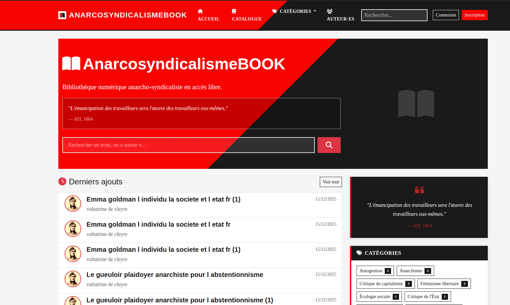

<!--
N.B.: This README was automatically generated by https://github.com/YunoHost/apps/tree/master/tools/readme_generator
It shall NOT be edited by hand.
-->

<h1 align="center">
  <br>
  AnarcosyndicalismeBOOK pour YunoHost
</h1>

<p align="center">
  
  
  
  
</p>

<p align="center">
  <a href="https://install-app.yunohost.org/?app=anarchosyndicalismebook"></a>
</p>

*[Read this README in English.](./README_en.md)*

> *Ce package vous permet d'installer AnarcosyndicalismeBOOK rapidement et simplement sur un serveur YunoHost.*
> *Si vous n'avez pas YunoHost, consultez [ce guide](https://yunohost.org/install) pour savoir comment l'installer et en profiter.*

## Vue d'ensemble

AnarcosyndicalismeBOOK est un CMS de bibliothèque numérique permettant de créer et gérer une bibliothèque en ligne de textes, documents PDF et EPUB.

Conçu pour les collectifs, associations, syndicats souhaitant diffuser des textes, les bibliothèques numériques militantes ou alternatives, et les projets d'archivage et de partage de documents.

### Fonctionnalités

- Lecture en ligne de PDF et EPUB avec mode plein écran
- Upload et gestion de fichiers (TXT, PDF, EPUB)
- Import en masse par drag & drop
- Import depuis Calibre (metadata.db ou serveur OPDS)
- Recherche par titre, auteur, contenu
- Organisation par catégories thématiques
- Favoris et liste de lecture personnelle
- **Authentification sécurisée (2FA/TOTP)**
- Flux RSS et sitemap XML dynamique
- PWA installable avec mode hors-ligne
- Widget d'accessibilité complet
- Partage social (Mastodon, Bluesky, Telegram, etc.)

**Version incluse :** 1.0.0~ynh18

**Licence :** MIT

## Captures d'écran



## Documentations et ressources

- Dépôt de code officiel de l'app : <https://gitlab.com/anarchymedialibertaire-group/anarcosyndicalismebook>
- YunoHost Store : <https://apps.yunohost.org/app/anarchosyndicalismebook>
- Signaler un bug : <https://gitlab.com/anarchymedialibertaire-group/anarcosyndicalismebook_ynh/-/issues>

## Informations pour les développeurs

Merci de faire vos merge requests sur la [branche `testing`](https://gitlab.com/anarchymedialibertaire-group/anarcosyndicalismebook_ynh/-/tree/testing).

Pour essayer la branche `testing`, procédez comme suit :

```bash
sudo yunohost app install https://gitlab.com/anarchymedialibertaire-group/anarcosyndicalismebook_ynh/-/archive/testing/anarcosyndicalismebook_ynh-testing.tar.gz --debug
```

ou

```bash
sudo yunohost app upgrade anarchosyndicalismebook -u https://gitlab.com/anarchymedialibertaire-group/anarcosyndicalismebook_ynh/-/archive/testing/anarcosyndicalismebook_ynh-testing.tar.gz --debug
```

**Plus d'infos sur le packaging d'applications :** <https://yunohost.org/packaging_apps>
## Première connexion

L'installation est entièrement automatique. Un compte administrateur est créé automatiquement.

Après l'installation, vous pouvez vous connecter à l'interface d'administration avec :
- **Email** : L'adresse email associée au compte administrateur YunoHost que vous avez choisi lors de l'installation (par exemple : `admin@votre-domaine.tld`).
- **Mot de passe** : Le mot de passe administrateur que vous avez défini lors de l'installation (champ "admin_password").

## Configuration hCaptcha

Si vous souhaitez utiliser hCaptcha pour protéger votre site, vous pouvez renseigner les clés lors de l'installation. Sinon, laissez les champs vides.
Pour obtenir des clés, inscrivez-vous sur [hCaptcha.com](https://www.hcaptcha.com/).
