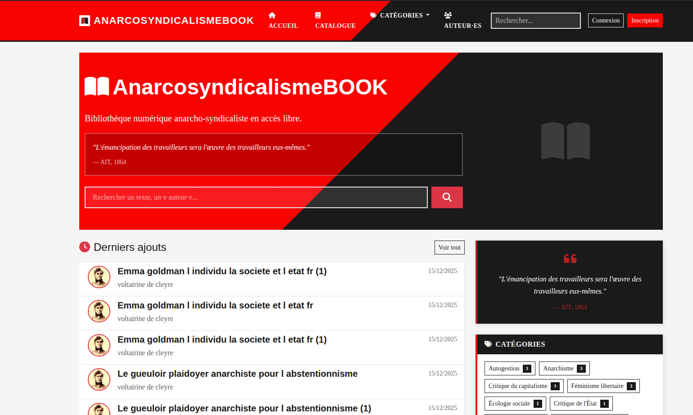

<!--
N.B.: This README was automatically generated by https://github.com/YunoHost/apps/tree/master/tools/readme_generator
It shall NOT be edited by hand.
-->

<h1 align="center">
  <br>
  AnarcosyndicalismeBOOK for YunoHost
</h1>

<p align="center">
  
  
  
  
</p>

<p align="center">
  <a href="https://install-app.yunohost.org/?app=anarcosyndicalismebook"></a>
</p>

*[Lire ce README en français.](./README.md)*

> *This package allows you to install AnarcosyndicalismeBOOK quickly and simply on a YunoHost server.*
> *If you don't have YunoHost, please consult [the guide](https://yunohost.org/install) to learn how to install it.*

## Overview

AnarcosyndicalismeBOOK is a digital library CMS for creating and managing an online library of texts, PDF and EPUB documents.

Designed for collectives, associations, unions wishing to share texts, alternative or activist digital libraries, and archiving and document sharing projects.

### Core Features

- **Integrated Reader**: Online reading of PDF and EPUB with full-screen mode and mobile touch interface.
- **File Management**: Upload and manage files (TXT, PDF, EPUB).
- **Mass Import**: Bulk import via drag & drop and metadata management.
- **Universal Migration**: Intelligent import from **Ghost CMS**, WordPress, or any **RSS/Atom** feed.
- **Calibre Sync**: Synchronize with Calibre or Wikisource (metadata.db or OPDS server).
- **Advanced Search**: Search by title, author, and content.
- **Organization**: Thematic categories, Favorites, and personal reading list.
- **Feeds & SEO**: RSS feeds, OPDS, and dynamic XML sitemap for better ranking.
- **PWA**: Installable web app with full offline mode.
- **Accessibility**: Comprehensive built-in accessibility widget (visual impairments, dyslexia).
- **Social & Sharing**: Social sharing (Mastodon, Bluesky, Telegram, etc.) and integrated Newsletter.
- **Security**: 2FA protection, Passkeys (WebAuthn), and CAP autonomous anti-bot protection.

**Shipped version:** 1.3.1~ynh4 (AnarcosyndicalismeBOOK LTS, commit 51b52a7)

**License:** MIT

## Screenshots



## Documentation and resources

- Upstream app code repository: <https://codeberg.org/Anarcosyndicalismebook/anarcosyndicalismebook>
- YunoHost Store: <https://apps.yunohost.org/app/anarcosyndicalismebook>
- Report a bug: <https://codeberg.org/Anarcosyndicalismebook/anarcosyndicalismebook_ynh/issues>

## Persistent data

YunoHost stores application data in its data directory (usually
`/home/yunohost.app/anarcosyndicalismebook`). The application's `uploads`,
`backups`, `logs`, and `releases` directories are linked there during
installation and upgrades. Do not add a Docker volume or change these paths
when running the YunoHost package.

## Developer info

Please send your merge request to the [testing branch](https://codeberg.org/Anarcosyndicalismebook/anarcosyndicalismebook_ynh/src/branch/testing).

To try the testing branch, please proceed like that:

```bash
sudo yunohost app install https://codeberg.org/Anarcosyndicalismebook/anarcosyndicalismebook_ynh/archive/testing.tar.gz --debug
```

or

```bash
sudo yunohost app upgrade anarcosyndicalismebook -u https://codeberg.org/Anarcosyndicalismebook/anarcosyndicalismebook_ynh/archive/testing.tar.gz --debug
```

**More info regarding app packaging:** <https://yunohost.org/packaging_apps>

## First login

Installation is fully automatic. An admin account is created during setup.

After install, log in with:
- **Email**: The email address of the YunoHost admin user you chose during install.
- **Password**: The password you entered in the "admin_password" field.

## CAP Anti-Bot Configuration

The CMS embeds **CAP** (open-source, privacy-first, zero-tracking, zero cookies).
If you have a CAP instance (local or remote), you can set its URL and keys during install or in **Admin > Settings > Anti-bot Protection (CAP)**. Otherwise, leave fields empty.
